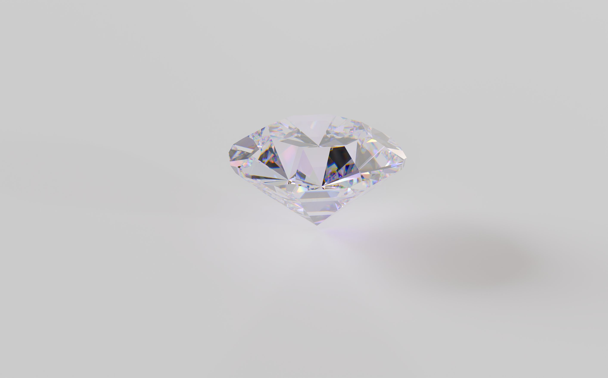

# rustracer

A physically-based path tracer built in Rust. It simulates how light actually behaves — bouncing, refracting, and scattering through a scene — to produce photorealistic images. It runs interactively in a window and can also render to PNG in headless mode.

**Scenes are TOML files.** There are no built-in scenes: the viewer, `--render`, and `--bench` all load a scene file (`scenes/scene.toml` / `scenes/bench.toml` by default, or anything you pass with `--scene`).

## Example output



`examples/702531654.pdf` (IGI cert) -> `py report_to_toml.py examples/702531654.pdf -o examples/702531654.toml`
-> `target/release/rustracer.exe --render --scene examples/702531654.toml --preset final --width 1280 --height 720 --output out.png`

The report PDF, the generated scene TOML and the 1502 spp + OIDN + AgX render all live in `examples/`.

## Build & Run

```sh
cargo run --release                        # interactive viewer (scenes/scene.toml)
cargo run --release -- --scene scenes/sample.toml         # interactive viewer, that scene file
cargo run --release -- --render [options]  # headless PNG render (--scene <path.toml>, default scenes/scene.toml)
cargo run --release -- --bench             # performance benchmark (scenes/bench.toml; pass another file to bench it)
```

Optional `denoise` cargo feature (OIDN, bundles its own binaries — no system install needed):

```sh
cargo build --release --features denoise
```

### Headless render options

```
--scene <path.toml>  scene file (default: scenes/scene.toml)
--samples <n>        samples per pixel (default: scene maximum; with --adaptive, the hard SPP cap)
--preset <name>      measured recipes: preview = 16 spp + OIDN 0.6, final = 64 spp + OIDN 1.0,
                     reference = adaptive, cap 4096 spp, raw.  Explicit flags override the preset.
--width/--height     output size in pixels (default: 1200x800)
--exposure <f>       exposure multiplier (default: 1.0)
--output <path>      output PNG path, or a directory in animation mode (default: auto-generated)
--tonemapper <name>  agx or aces (default: agx)
--adaptive           adaptive sampling: run until the convergence target is reached
--convergence <pct>  convergence target in % (default: 99.0; requires --adaptive)
--min-samples <n>    minimum SPP before any pixel may be marked converged (default: 128; requires --adaptive)
--frames <n>         render only the first N frames of a scene animation; 1 = single still (default: all)
--spin <deg>         override every [[gems]] spin (static rotation about the gem's own axis); render one crisp still per angle
--no-photon-map      disable caustic photon map (faster, no caustics)
--firefly <f>        firefly clamp multiplier vs running mean (default 8.0; 0 = off)
--firefly-floor <f>  absolute luminance floor of the clamp threshold (default 5.0)
--denoise [strength] run OIDN after render; optional blend in [0.0, 1.0] (default: 1.0; requires the denoise feature)
```

Recommended workflow: render once with `--preset reference`, iterate with `--preset preview`, ship with
`--preset final`, and check the result with `render_qa.py` (see Tools below).

### Firefly control

Specular highlights and caustic paths occasionally produce a single sample far brighter than the
pixel's running mean (a "firefly"). The renderer clamps any sample whose luminance exceeds
`max(--firefly × running pixel mean, --firefly-floor)` down to that threshold, but only after
`FIREFLY_MIN_SAMPLES` (4) samples so a dark pixel's first legitimate bright sample isn't crushed
(the floor exists for the same reason). This biases high-variance pixels slightly dark, which is
usually invisible and keeps interactive previews clean.

- Default `--firefly 8.0 --firefly-floor 5.0` is right for previews and most stills.
- For final high-SPP renders prefer `--firefly 0 --denoise`: clamping off (no bias) and let OIDN
  remove the speckles instead. Lower values (e.g. `--firefly 16`) only if you render raw without
  the denoiser.
- `spin_stills.py --firefly <f>` forwards the flag to every still of a spin series.

## Controls

| Key | Action |
|-----|--------|
| F | Toggle free camera (WASD + mouse look) |
| C | Reset camera |
| R | Reload the scene file (edit the TOML, press R) |
| Space / Shift | Move up / down (free cam) |
| , / . | Decrease / increase FOV |
| I / O | Decrease / increase aperture |
| - / = | Decrease / increase exposure |
| Arrows | Rotate sun (physical-sky scenes) |
| T | Toggle tonemapper (AgX / ACES) |
| V | Toggle adaptive sampling |
| M | Toggle photon map (caustics on/off) |
| L | Print current camera position to terminal (TOML format) |
| P | Save PNG |
| Enter | Pause / resume rendering |
| N | Toggle OIDN denoising (`denoise` feature) |
| J / K | Decrease / increase denoise blend |
| ? | Reprint controls |
| Esc | Release mouse / quit |

## Tools

- **`render_qa.py`** — render QA: artifact detection (black dots, fireflies, hue outliers), sanity stats
  (crushed/cliped %, noise σ, degenerate-image fail), and optional reference comparison:

  ```sh
  py render_qa.py render.png                          # artifacts + grade
  py render_qa.py a.png b.png                         # comparison table
  py render_qa.py render.png --reference ref.png      # + linear-space RMSE/PSNR vs a high-spp render
  py render_qa.py render.png --json                   # machine-readable (always a JSON list)
  py render_qa.py render.png --annotate               # save render_qa.png with circles
  ```

- **`scenes/assets/`** - env maps, textures, meshes. Generated gem scenes (see below) use the
  purchased Poly Haven 8k lightbox HDR `studio_small_09_8k.hdr` (bilinear sampling; `--env` picks
  (other maps via `--env`, e.g. `studio_kontrast_04_8k.hdr`). Purchased assets stay local
  (git-ignored); `scenes/scene.toml` demos with the local `sunset_puresky_4k.hdr`.

- **`report_to_toml.py`** — turns an IGI/GIA grading-report PDF into a renderable `scenes/<report>.toml`
  (stdlib only; see "From a grading-report PDF" below):
  `py report_to_toml.py 625469899.pdf [--env assets/studio_kontrast_04_8k.hdr] [--material X] [--cut Y] [--gap-mm 0.0] [--no-chart] [--lights] [--no-caustics] [--no-animation]`
- **`spin_stills.py`** — renders a gem-rotation still series (one crisp still per `--spin <deg>`,
  no motion blur, camera fixed):
  `py spin_stills.py scenes/625469899.toml [-n 96] [-o out/] [--preset final --width 1280 --height 720] [--tonemapper agx|aces] [--exposure f] [--dry-run]`

## Features

### Rendering

Path tracing works by sending many rays from the camera into the scene. Each ray bounces around — hitting surfaces, scattering, sometimes hitting a light — and the average of thousands of these paths gives you the final pixel colour. More samples per pixel means less noise.

- **Unidirectional path tracing** with full global illumination (indirect lighting, colour bleeding, soft shadows — all emerge naturally from the simulation)
- **Next-event estimation (NEE) with MIS** — at each diffuse bounce, shadow rays are cast directly toward area lights, the sun, and the env map. Contributions are combined with the MIS **power heuristic (β = 2)** over all strategies (`wᵢ = pᵢ² / Σpⱼ²`), which partitions unity exactly; emission is never double-counted with NEE.
- **Cosine-weighted hemisphere sampling** for diffuse indirect bounces — samples are biased toward directions that contribute more energy, reducing variance without introducing bias
- **Depth of field** — rays are scattered across a simulated lens aperture, producing realistic out-of-focus blur. Bokeh shape is controlled by a configurable blade count.
- **Motion blur** - in animated scenes, each frame's rays are jittered over that frame's own time slice [t, t+1/fps); only time-varying elements are affected, so static TOML scenes render crisp stills

### Spectral rendering

Most path tracers work entirely in RGB — red, green, and blue channels. This tracer optionally goes further by simulating actual wavelengths of light, which enables physically correct phenomena that RGB cannot reproduce.

- **Hero-wavelength spectral rendering** — one wavelength λ (between 380 and 700 nm) is sampled per camera ray and tracked through all bounces. The final colour is reconstructed using the CIE 1931 colour matching functions.
- **SpectralDielectric** — glass whose refractive index depends on wavelength (Cauchy equation: `n(λ) = B + C/λ²`). Different colours bend by different amounts, and at the first dispersive *refraction* the luminance-weighted CMF tint `spectral_fire_rgb(λ)` is folded into the throughput (applied once per path; external Fresnel reflection stays white), producing chromatic aberration, diamond fire, and rainbow caustics. The tint is weighted by ȳ(λ)^0.5 so violet fire is dimmer than green/yellow — dispersed white light stays white on average but reads as a balanced rainbow, not purple. Gem presets use physical constants (diamond nD 2.417, nF−nC ≈ 0.044). The fire tint is desaturated 50% toward its own luminance by default (`FIRE_DESAT` env var, 0–1) so dispersed white light stays white on average and the caustic under the culet is neutral instead of lavender, while fine fire remains.
- **SpectralMetal** — conductor Fresnel reflectance computed from measured IOR data (Johnson & Christy 1972) for gold, copper, and silver.

### Acceleration

- **QBVH (8-wide Bounding Volume Hierarchy)** — the scene is wrapped in a tree of axis-aligned bounding boxes. Ray traversal tests 8 child nodes simultaneously using AVX2 SIMD instructions, with a 4-wide SSE2/NEON fallback on other hardware. Shadow rays use a faster `any_hit()` variant that exits at the first hit.
- **Parallelised row rendering** via Rayon — image rows are rendered by separate CPU threads simultaneously
- **Adaptive sampling** — per-pixel per-channel variance (Welford online algorithm) tracks convergence; converged pixels are skipped in later passes. A hard SPP cap (`--samples` or the scene's `max_samples`) guarantees termination, and non-finite samples are dropped instead of poisoning the accumulator.

### Caustics (Photon Mapping)

Caustics are the bright, curved light patterns formed when light focuses through a curved transparent surface. This tracer uses a **photon map**: a separate forward-tracing pass shoots photons from the light source, stores where they land after specular bounces, and builds a kd-tree over them. During the main render, the local photon density estimates caustic radiance.

- Balanced kd-tree (median-split, widest-axis) built once per scene/frame
- Epanechnikov kernel density estimation
- Hemisphere normal filtering rejects photons whose stored normal opposes the shading normal — no caustic leakage through opaque geometry
- Photons are stored after any specular bounce (plain glass included, not just spectral materials)
- Emitter: the sun for `physical` backgrounds, a luminance-sampled bright direction for `env_map` backgrounds, or the first `[[lights]]` quad for `solid` backgrounds
- The sun/env emission disk is sized from the *real* geometry only (`Hittable::photon_bounds()` — infinite planes are excluded), so plane-floor scenes get a tight disk and a populated caustic map instead of wasting ~all photons; the photon storage luminance clamp scales with the disk area to stay sun-proportional at any scene scale

### Backgrounds

Three background modes, configured per scene:

```toml
[background]
type = "physical"          # Preetham sky + sun disk
sun_azimuth   = -55.0      # degrees clockwise from +Z
sun_elevation = 32.0       # degrees above the horizon
turbidity     = 3.0        # must be >= 1.7
```

```toml
[background]
type = "env_map"           # equirectangular HDR (.hdr Radiance RGBE or .exr in linear sRGB --
                            # for ACEScg downloads use the *_sRGBlinear file; v=0 = zenith; bilinear)
path = "assets/sunset_puresky_4k.hdr"
# rotate_y = 90.0                        # optional: yaw-rotate the env map (degrees)
# visible = { type = "solid", color = [1.0, 1.0, 1.0] }  # optional: backdrop seen on miss rays;
                                                       # or { type = "gradient", top = [1,1,1], bottom = [0.8,0.8,0.8] } for a seamless sweep;
                                                       # the env map still provides all lighting
```

```toml
[background]
type  = "solid"
color = [0.002, 0.002, 0.005]
```

Environment maps are importance-sampled with a 2D CDF built from luminance × sin θ, and NEE samples them directly at diffuse bounces. Files of any size load (no memory cap).

### Materials

TOML material types (see `scenes/scene.toml` for a full annotated example):

| TOML type | Description |
|-----------|-------------|
| `lambertian` | Cosine-weighted diffuse with a solid `color` |
| `checker` | 3-D checker, `even`/`odd` colours, `scale` = tile size in world units |
| `image` | Lambertian with an sRGB image texture (`path`) |
| `metal` | `color` + `fuzz`, maps to a metallic PBR |
| `dielectric` | Glass with exact Fresnel (Rs/Rp) and TIR, configurable `ior` |
| `spectral_dielectric` | Dispersive glass, `ior` at the d-line + `dispersion` (Cauchy) |
| `spectral_metal` | `variant` = gold/copper/silver (J&C 1972), `roughness` |
| `pbr` | Full GGX microfacet BRDF — anisotropic VNDF sampling (Heitz 2018), metallic/roughness, clearcoat, sheen |
| `textured_pbr` | PBR driven by image maps (albedo/roughness/metallic/ao/normal) |
| `sss` | Subsurface scattering: `albedo`, `sigma_a`, `ior`, `density`, `g` (Beer–Lambert + Henyey–Greenstein) |
| `pearl` | Thin-film iridescence with a nacre LUT; colour shifts with view angle |
| `diffuse_light` | Flat-colour emitter; values > 1.0 are HDR-bright |

Emitters in `[[lights]]` are quads (`corner`, `u`, `v`, `color`) that also join the NEE light list; optionally `temp_k` + `intensity` make the emitter a Planck blackbody (spectrally weighted).

`textured_pbr` supports **tangent-space normal maps** (OpenGL convention; per-vertex tangents from UV derivatives, Gram-Schmidt at shade time, TBN transform into world space).

### Post-processing

- **AgX** tonemapper (default) — filmic response curve that handles very bright highlights gracefully (Troy Sobotka)
- **ACES** tonemapper — the full RRT + ODT film pipeline
- Exact IEC 61966-2-1 sRGB encode (256-entry LUT) on save
- Optional **OIDN denoising** — runs on a background thread, updates every 32 samples, blend adjustable with J/K

## Custom scenes (TOML)

The viewer loads `scenes/scene.toml` by default, or `--scene path/to/file.toml`;
press **R** to hot-reload after editing. `--render --scene <path.toml>` renders headless.
Asset paths inside a scene file (env maps, textures, OBJ meshes) resolve relative to the
scene file's own folder first, then the working directory — that is why `scenes/` carries
its own `assets/` subfolder.

**`scenes/sample.toml` is the full parameter reference** — every section (`[camera]`,
`[background]`, `[[objects]]` shapes + transforms + materials, `[[lights]]`, `[[gems]]`,
`[caustics]`, `[animation]`) with every field commented. Copy it to start a new scene;
the other files in `scenes/` are working examples.

Gem cuts: `diamond` is the brilliant family (round, or oval via `oval_ratio > 1`) and
`step_cut` the step-cut family (polygon girdle outline, stepped rows, optional chevrons);
`[[gems]]` `cut = "..."` presets cover brilliant / step (emerald) / princess / asscher /
radiant / baguette / cushion / trillion / marquise / pear. All cuts are analytic convex
polyhedra (half-space intersection, ray cost O(planes)); non-convex cuts (hearts,
clover) need an OBJ mesh.

## From a grading-report PDF

`py report_to_toml.py REPORT.pdf` (Python stdlib only) pulls the IGI/GIA fields straight out of the
PDF's FlateDecode text streams — report number/date, description (-> material preset), cutting
style (-> cut preset), measurements, carat weight, color/clarity grades, the proportions
diagram (crown% / table% / pavilion% / depth%; both the classic '... PROPORTIONS' layout and
the newer crown/pavilion/culet/depth/table layout are parsed), the girdle descriptor (single
word or range like 'Slightly Thick To Thick' -> midpoint %) and the girdle condition
('(Faceted)' / '(Polished)' / '(Bruted)' -> `girdle_finish`, which gives a faceted girdle its
wavy/alveola band; uniform/polished/bruted girdles instead get a smooth cylindrical outline (fine 64-gon shell, 0.12% deviation) with the facet planes attached inside it). Gem `material` also accepts the debug values `"checker"` / `"opaque"` to render the raw facet geometry (facet layout/normals check) — and writes a ready-to-render scene TOML into
`scenes/` (next to this script):

```
py report_to_toml.py 625469899.pdf        # writes scenes/625469899.toml
cargo run --release -- --scene scenes/625469899.toml
```

By default the generated scene rests the stone in contact (gap 0) centered on a grey chart card (the purchased
`greyChart_OBJ.obj` mesh, textured with its sRGB TIFF, at true scale - 18 cm wide, i.e. 180/L_mm stone lengths) on a pbr disk floor (radius 30), lit by
the `assets/studio_small_09_8k.hdr` env map alone (`--env` to change) on a white seamless backdrop (`--bg-env` to show the env itself); `--no-chart` drops the card, `--gap-mm` floats the stone.

The stone is staged in bright product lighting - a studio lightbox env map
(`assets/studio_small_09_8k.hdr`, the purchased 8k lightbox HDR, default; `--env` switches) as the sole light source; `--lights` adds angled overhead softbox `[[lights]]` quads (geometric, so
facets catch crisp streaks) over a pbr disk floor (radius 30), Blue Nile style —
with caustics on (photon map: 2,000,000 photons with a tight gather radius, so the caustic stays a sharp bright flash at the contact point instead of a diffuse smudge). The env map is yawed `rotate_y = 270.0` by default so its key light sits overhead: the stone throws a compact shadow with the caustic concentrated right under the culet, not a soft blob offset to the side. Generated scenes are normalized so the stone's length is exactly 1 scene unit
(all distances, camera, photon radius derive from it); the scene also ships a
ready-to-render `[animation]` / `[animation.orbit]` block derived from the fixed camera offset around the stone centre
(look_at = stone centre, look_from = look_at + [2.5840, 2.1961, -4.5380],
vfov 20 deg), so every stone gets identical framing and frame 0 of the turntable is
exactly the still shot (full 360-degree orbit, 96 frames at 24 fps). Overrides: `--material`,
`--cut`, `--gap-mm`, `--no-chart`, `--lights`, `--no-caustics`, `--no-animation`. Unparseable fields produce warnings,
never a broken file.

Gem-rotation still series (static `spin` per still — crisp, no motion blur, camera fixed;
the `[animation.orbit]` block above is the camera turntable instead):

```sh
py spin_stills.py scenes/625469899.toml     # 96 crisp stills -> renders/625469899_spin/
# add --tonemapper aces --exposure 0.8 to pass those to every still
ffmpeg -r 24 -i renders/625469899_spin/gem_%04d.png -c:v libx264 -pix_fmt yuv420p gem_spin.mp4
```
The report PDFs and the per-stone scenes they generate stay local (git-ignored) — only
`scenes/scene.toml`, `scenes/sample.toml` and `scenes/bench.toml` are tracked. Purchased Poly Haven assets (grey chart OBJ/TIFF, lightbox EXR, cameras) stay local too.

## Implementation notes

- Release builds use `target-cpu=native`, fat LTO, and a single codegen unit
- QBVH node width (8 vs 4) is selected at compile time via `#[cfg(target_feature = "avx2")]`; SAH-binned build; traversal uses an inline stack with a Vec overflow
- Spectral CMF weight is applied at the first spectral bounce via a `spectral_weighted` flag; later bounces multiply by a scalar reflectance so the weight is never compounded
- MIS power heuristic (β=2) with the sum of squares over area/sun/env/BRDF strategies — a true partition of unity; emission gets weight 1 on camera rays and after specular bounces, MIS weight after diffuse ones
- Env map importance sampling: 2D CDF (row marginal × per-row conditional) from luminance × sin θ, two-level binary search with sub-pixel jitter; solid-angle PDF `p_ω = L·W·H·inv_total / (2π²)` feeds the MIS weights
- Shading normals from normal maps feed all PDF/BRDF paths (`scattering_pdf`, `specular_brdf_cos`, `specular_sampling_pdf`, `CosinePdf`), keeping MIS consistent with the actual scattering geometry
- Photon kd-tree: `select_nth_unstable_by` median partition, split-plane pruned queries
- Adaptive sampling: per-channel Welford variance, relative threshold `ADAPTIVE_THRESHOLD`, min-samples floor, hard SPP cap, non-finite samples dropped; converged pixels are skipped in later passes
- OIDN runs on a background thread and blends into the display without blocking the render loop
- Normal-map tangents: per-face tangents accumulated per-vertex at OBJ load, normalised + Gram-Schmidt at shade time

### Compile-time tuning knobs

| Constant | File | Default | Effect |
|---|---|---|---|
| `MAX_DEPTH` | `src/renderer.rs` | `50` | Maximum ray bounce depth. Lower cuts render time but loses energy in glass/mirror-heavy scenes. |
| `ADAPTIVE_THRESHOLD` | `src/main.rs` | `0.05` | Relative standard error (σ/μ, per channel) below which a pixel is converged and skipped. |
| `FIREFLY_CLAMP` | `src/main.rs` | `8.0` | Default for the runtime `--firefly` flag: samples above `max(clamp × running pixel mean, floor)` luminance are scaled down to that threshold. Downward bias on high-variance pixels — use `--denoise` for bias-free firefly suppression in finals, or `--firefly 0` to disable. |
| `FIREFLY_MIN_SAMPLES` | `src/main.rs` | `4` | Minimum samples before per-pixel firefly clamping activates. |
| `FIREFLY_ABS_FLOOR` | `src/main.rs` | `5.0` | Absolute floor (linear luminance) for the clamp threshold — without it, a pixel whose running mean is still ~0 clamps its first legitimate bright sample to ~0 and renders black. |
| `FIRE_LUMA_POW` | `src/spectrum.rs` | `0.5` | Exponent applied to the photopic luminance ȳ(λ) in the `spectral_fire_rgb` dispersion tint. Higher (→1.0) dims violet/blue fire harder so the gem reads warmer/whiter; lower (→0.0) gives full rainbow fire with more blue/violet sparkle. The tint stays per-channel normalised, so white light is white on average at any value. |
| `FIRE_LUMA_FLOOR` | `src/spectrum.rs` | `0.08` | Floor for the ȳ(λ)^`FIRE_LUMA_POW` weight so deep violet (380–420 nm) is dimmed, not erased, in the fire tint. |
