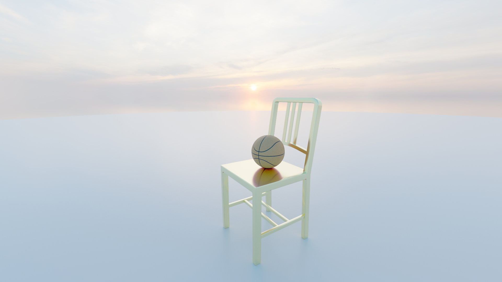

# rustracer

A physically-based path tracer built in Rust. It simulates how light actually behaves — bouncing, refracting, and scattering through a scene — to produce photorealistic images. It runs interactively in a window and can also render to PNG in headless mode.

**Scenes are TOML files.** There are no built-in scenes: the viewer, `--render`, and `--bench` all load a scene file (`scene.toml` / `bench.toml` by default, or anything you pass with `--scene`).

## Gallery

| OBJ loading (`scene.toml` — default demo scene) |
|:---:|
|  chair + basketball OBJ meshes, PBR textures, HDR sky — render your own gem with `gem_LG625469749.toml` |

### Animation — 360° orbit

Camera orbit around the chair and basketball (`scene.toml` has an `[animation.orbit]` section), 144 frames at 24 fps.

[Watch the orbit animation](examples/obj_loading.mp4)

(The older `render_random_spheres` / `render_cornell_box` / `render_next_week` images in `examples/` are renders of the built-in scenes that were removed when the project switched to TOML-only scenes.)

## Build & Run

```sh
cargo run --release                        # interactive viewer (scene.toml)
cargo run --release -- --scene gem_LG625469749.toml   # interactive viewer, that scene file
cargo run --release -- --render [options]  # headless PNG render (--scene <path.toml>, default scene.toml)
cargo run --release -- --bench             # performance benchmark (bench.toml; pass another file to bench it)
```

Optional `denoise` cargo feature (OIDN, bundles its own binaries — no system install needed):

```sh
cargo build --release --features denoise
```

### Headless render options

```
--scene <path.toml>  scene file (default: scene.toml)
--samples <n>        samples per pixel (default: scene maximum; with --adaptive, the hard SPP cap)
--preset <name>      measured recipes: preview = 16 spp + OIDN 0.6, final = 64 spp + OIDN 1.0,
                     reference = adaptive, cap 4096 spp, raw.  Explicit flags override the preset.
--width/--height     output size in pixels (default: 1200x800)
--exposure <f>       exposure multiplier (default: 1.0)
--output <path>      output PNG path, or a directory in animation mode (default: auto-generated)
--tonemapper <name>  agx or aces (default: agx)
--adaptive           adaptive sampling: run until the convergence target is reached
--convergence <pct>  convergence target in % (default: 99.0; requires --adaptive)
--min-samples <n>    minimum SPP before any pixel may be marked converged (default: 128; requires --adaptive)
--frames <n>         render only the first N frames of a scene animation; 1 = single still (default: all)
--no-photon-map      disable caustic photon map (faster, no caustics)
--denoise [strength] run OIDN after render; optional blend in [0.0, 1.0] (default: 1.0; requires the denoise feature)
```

Recommended workflow: render once with `--preset reference`, iterate with `--preset preview`, ship with
`--preset final`, and check the result with `render_qa.py` (see Tools below).

## Controls

| Key | Action |
|-----|--------|
| F | Toggle free camera (WASD + mouse look) |
| C | Reset camera |
| R | Reload the scene file (edit the TOML, press R) |
| Space / Shift | Move up / down (free cam) |
| , / . | Decrease / increase FOV |
| I / O | Decrease / increase aperture |
| - / = | Decrease / increase exposure |
| Arrows | Rotate sun (physical-sky scenes) |
| T | Toggle tonemapper (AgX / ACES) |
| V | Toggle adaptive sampling |
| M | Toggle photon map (caustics on/off) |
| L | Print current camera position to terminal (TOML format) |
| P | Save PNG |
| Enter | Pause / resume rendering |
| N | Toggle OIDN denoising (`denoise` feature) |
| J / K | Decrease / increase denoise blend |
| ? | Reprint controls |
| Esc | Release mouse / quit |

## Tools

- **`render_qa.py`** — render QA: artifact detection (black dots, fireflies, hue outliers), sanity stats
  (crushed/cliped %, noise σ, degenerate-image fail), and optional reference comparison:

  ```sh
  py render_qa.py render.png                          # artifacts + grade
  py render_qa.py a.png b.png                         # comparison table
  py render_qa.py render.png --reference ref.png      # + linear-space RMSE/PSNR vs a high-spp render
  py render_qa.py render.png --json                   # machine-readable (always a JSON list)
  py render_qa.py render.png --annotate               # save render_qa.png with circles
  ```

- **`make_studio_softbox.py`** — regenerates `assets/studio_softbox.hdr`, the procedural "light tent"
  env map used by the gem scene (gradient base + soft glows + warm `TINT`); run `py make_studio_softbox.py`.

## Features

### Rendering

Path tracing works by sending many rays from the camera into the scene. Each ray bounces around — hitting surfaces, scattering, sometimes hitting a light — and the average of thousands of these paths gives you the final pixel colour. More samples per pixel means less noise.

- **Unidirectional path tracing** with full global illumination (indirect lighting, colour bleeding, soft shadows — all emerge naturally from the simulation)
- **Next-event estimation (NEE) with MIS** — at each diffuse bounce, shadow rays are cast directly toward area lights, the sun, and the env map. Contributions are combined with the MIS **power heuristic (β = 2)** over all strategies (`wᵢ = pᵢ² / Σpⱼ²`), which partitions unity exactly; emission is never double-counted with NEE.
- **Cosine-weighted hemisphere sampling** for diffuse indirect bounces — samples are biased toward directions that contribute more energy, reducing variance without introducing bias
- **Depth of field** — rays are scattered across a simulated lens aperture, producing realistic out-of-focus blur. Bokeh shape is controlled by a configurable blade count.
- **Motion blur** — in animated scenes, each frame's rays are jittered over that frame's own time slice `[t, t+1/fps)`

### Spectral rendering

Most path tracers work entirely in RGB — red, green, and blue channels. This tracer optionally goes further by simulating actual wavelengths of light, which enables physically correct phenomena that RGB cannot reproduce.

- **Hero-wavelength spectral rendering** — one wavelength λ (between 380 and 700 nm) is sampled per camera ray and tracked through all bounces. The final colour is reconstructed using the CIE 1931 colour matching functions.
- **SpectralDielectric** — glass whose refractive index depends on wavelength (Cauchy equation: `n(λ) = B + C/λ²`). Different colours bend by different amounts, producing chromatic aberration and rainbow caustics.
- **SpectralMetal** — conductor Fresnel reflectance computed from measured IOR data (Johnson & Christy 1972) for gold, copper, and silver.

### Acceleration

- **QBVH (8-wide Bounding Volume Hierarchy)** — the scene is wrapped in a tree of axis-aligned bounding boxes. Ray traversal tests 8 child nodes simultaneously using AVX2 SIMD instructions, with a 4-wide SSE2/NEON fallback on other hardware. Shadow rays use a faster `any_hit()` variant that exits at the first hit.
- **Parallelised row rendering** via Rayon — image rows are rendered by separate CPU threads simultaneously
- **Adaptive sampling** — per-pixel per-channel variance (Welford online algorithm) tracks convergence; converged pixels are skipped in later passes. A hard SPP cap (`--samples` or the scene's `max_samples`) guarantees termination, and non-finite samples are dropped instead of poisoning the accumulator.

### Caustics (Photon Mapping)

Caustics are the bright, curved light patterns formed when light focuses through a curved transparent surface. This tracer uses a **photon map**: a separate forward-tracing pass shoots photons from the light source, stores where they land after specular bounces, and builds a kd-tree over them. During the main render, the local photon density estimates caustic radiance.

- Balanced kd-tree (median-split, widest-axis) built once per scene/frame
- Epanechnikov kernel density estimation
- Hemisphere normal filtering rejects photons whose stored normal opposes the shading normal — no caustic leakage through opaque geometry
- Photons are stored after any specular bounce (plain glass included, not just spectral materials)
- Emitter: the sun for `physical` backgrounds, a luminance-sampled bright direction for `env_map` backgrounds, or the first `[[lights]]` quad for `solid` backgrounds

### Backgrounds

Three background modes, configured per scene:

```toml
[background]
type = "physical"          # Preetham sky + sun disk
sun_azimuth   = -55.0      # degrees clockwise from +Z
sun_elevation = 32.0       # degrees above the horizon
turbidity     = 3.0        # must be >= 1.7
```

```toml
[background]
type = "env_map"           # equirectangular HDR (.hdr Radiance RGBE or .exr), v=0 = zenith
path = "assets/sunset_puresky_4k.hdr"
```

```toml
[background]
type  = "solid"
color = [0.002, 0.002, 0.005]
```

Environment maps are importance-sampled with a 2D CDF built from luminance × sin θ, and NEE samples them directly at diffuse bounces. Files of any size load (no memory cap).

### Materials

TOML material types (see `scene.toml` for a full annotated example):

| TOML type | Description |
|-----------|-------------|
| `lambertian` | Cosine-weighted diffuse with a solid `color` |
| `checker` | 3-D checker, `even`/`odd` colours, `scale` = tile size in world units |
| `image` | Lambertian with an sRGB image texture (`path`) |
| `metal` | `color` + `fuzz`, maps to a metallic PBR |
| `dielectric` | Glass with exact Fresnel (Rs/Rp) and TIR, configurable `ior` |
| `spectral_dielectric` | Dispersive glass, `ior` at the d-line + `dispersion` (Cauchy) |
| `spectral_metal` | `variant` = gold/copper/silver (J&C 1972), `roughness` |
| `pbr` | Full GGX microfacet BRDF — anisotropic VNDF sampling (Heitz 2018), metallic/roughness, clearcoat, sheen |
| `textured_pbr` | PBR driven by image maps (albedo/roughness/metallic/ao/normal) |
| `sss` | Subsurface scattering: `albedo`, `sigma_a`, `ior`, `density`, `g` (Beer–Lambert + Henyey–Greenstein) |
| `pearl` | Thin-film iridescence with a nacre LUT; colour shifts with view angle |
| `diffuse_light` | Flat-colour emitter; values > 1.0 are HDR-bright |

Emitters in `[[lights]]` are quads (`corner`, `u`, `v`, `color`) that also join the NEE light list; optionally `temp_k` + `intensity` make the emitter a Planck blackbody (spectrally weighted).

`textured_pbr` supports **tangent-space normal maps** (OpenGL convention; per-vertex tangents from UV derivatives, Gram-Schmidt at shade time, TBN transform into world space).

### Post-processing

- **AgX** tonemapper (default) — filmic response curve that handles very bright highlights gracefully (Troy Sobotka)
- **ACES** tonemapper — the full RRT + ODT film pipeline
- Exact IEC 61966-2-1 sRGB encode (256-entry LUT) on save
- Optional **OIDN denoising** — runs on a background thread, updates every 32 samples, blend adjustable with J/K

## Custom scenes (TOML)

The viewer loads `scene.toml` from the working directory by default, or `--scene path/to/file.toml`;
press **R** to hot-reload after editing. `--render --scene <path.toml>` renders headless.

```toml
name = "My Scene"
max_samples = 2000

[camera]
look_from  = [0.0, 2.0, 5.0]
look_at    = [0.0, 1.0, 0.0]
vfov       = 40.0
aperture   = 0.0            # depth of field; aperture_blades = 0/5/6/8 for bokeh shape
focus_dist = 5.0            # optional; defaults to look_from->look_at distance
move_speed = 0.5            # free-cam step per keypress (scale it to your scene!)
```

### Shapes

```toml
[[objects]]
shape    = { type = "sphere",         center = [x,y,z], radius = r }
material = { type = "lambertian", color = [r,g,b] }

# other shapes:
# { type = "quad",           corner = [x,y,z], u = [x,y,z], v = [x,y,z] }
# { type = "box",            p_min = [x,y,z],  p_max = [x,y,z] }
# { type = "cylinder",       center = [x,y,z], radius = r, height = h }
# { type = "cone",           center = [x,y,z], radius = r, height = h }
# { type = "disk",           center = [x,y,z], normal = [x,y,z], radius = r }
# { type = "infinite_plane", point  = [x,y,z], normal = [x,y,z] }
# { type = "mesh",           path   = "assets/file.obj" }
# { type = "diamond",        center = [x,y,z], radius = r, table_pct = 53.0,
#                             crown_angle = 34.5, pavilion_angle = 40.75, oval_ratio = 1.0 }
# volume shapes (material field ignored; density+color inline):
# { type = "constant_volume_sphere", center, radius, density, color, g = 0.0 }
# { type = "constant_volume_box",    p_min, p_max, density, color, g = 0.0 }
# { type = "noise_volume_sphere",   center, radius, density, color, g = 0.0 }
# { type = "noise_volume_box",      p_min, p_max, density, color, g = 0.0 }
```

> Use `disk` rather than `infinite_plane` when an env map is the background — an infinite plane extends to the horizon and clips into the sky.

Per-object transforms, applied in SRT order (scale → rotate_y → translate):

```toml
scale     = 0.01        # e.g. cm -> m for most OBJ exports
rotate_y  = 90.0        # degrees around world Y
translate = [x, y, z]
```

### Lights, gems, caustics

```toml
[[lights]]              # emissive quad; joins the NEE light list
corner = [0.0, 5.0, 0.0]
u      = [3.0, 0.0, 0.0]
v      = [0.0, 0.0, 3.0]
color  = [8.0, 8.0, 8.0]
# temp_k = 6500.0     # optional blackbody emitter (color ignored)
# intensity = 8.0

[[gems]]                # gem built from a grading report (IGI/GIA fields)
report          = "LG625469749 (IGI 2024-03-09, ...)"
carat           = 1.50
measurements_mm = [8.99, 6.42, 3.97]   # L x W x D mm (overrides carat for size)
table_pct       = 58.0
crown_pct       = 16.0                 # IGI proportions-diagram style (% of minor axis)
pavilion_pct    = 41.0
depth_pct       = 61.8                 # cross-checked against the angles
color_grade     = "E"                  # Beer-Lambert tint from the grade
center          = [0.0, 0.02, 0.0]
scale_mm        = 0.001                # mm -> metres

[caustics]
enabled       = true
gather_radius = 0.15      # world units; increase for smoother, decrease for sharper
num_photons   = 500_000   # small objects need more (5_000_000 for a small diamond)
```

### Animation

```toml
[animation]
fps      = 24
duration = 6.0            # fps x duration = frame count

[animation.orbit]         # perfect circular camera path
center      = [0.0, 0.0, 0.0]
radius      = 4.5
height      = 2.0
look_at     = [0.0, 1.0, 0.0]
start_angle = 0.0         # degrees; 0 = +Z from center
end_angle   = 360.0
# vfov / aperture / focus_dist optional (inherit from [camera])
```

or `[[animation.keyframes]]` entries (`time`, `look_from`, `look_at`, optional `vfov`/`aperture`/`focus_dist`) for a Catmull-Rom camera path.

Render a video — one PNG per frame plus a printed ffmpeg command:

```sh
cargo run --release --features denoise -- --render --scene myfile.toml --preset final --width 1280 --height 720 --output frames
```

Frame files are `{slug}_{frame:04d}.png`. Use `--frames 1` for a single still (`--output` is then a file path, not a directory). The BVH and photon map are built once and reused across frames; each frame motion-blurs over its own 1/fps time slice.

## Scenes shipped in the repo

1. **`scene.toml`** — default demo: old wooden chair and basketball OBJ meshes with PBR textures (normal map on the basketball), concrete disk floor, sunset HDR env map, orbit animation.
2. **`diamond.toml`** — round brilliant diamond under a Preetham sun sky with caustics and a turntable animation.
3. **`gem_LG625469749.toml`** — your IGI-graded stone as an oval brilliant (`[[gems]]`), floating in a procedural studio light-tent HDR (`assets/studio_softbox.hdr`), caustics on.
4. **`bench.toml`** — the `--bench` reference scene (room + blackbody panel + spectral-glass caustics + SSS + 127k-face mesh).

## Implementation notes

- Release builds use `target-cpu=native`, fat LTO, and a single codegen unit
- QBVH node width (8 vs 4) is selected at compile time via `#[cfg(target_feature = "avx2")]`; SAH-binned build; traversal uses an inline stack with a Vec overflow
- Spectral CMF weight is applied at the first spectral bounce via a `spectral_weighted` flag; later bounces multiply by a scalar reflectance so the weight is never compounded
- MIS power heuristic (β=2) with the sum of squares over area/sun/env/BRDF strategies — a true partition of unity; emission gets weight 1 on camera rays and after specular bounces, MIS weight after diffuse ones
- Env map importance sampling: 2D CDF (row marginal × per-row conditional) from luminance × sin θ, two-level binary search with sub-pixel jitter; solid-angle PDF `p_ω = L·W·H·inv_total / (2π²)` feeds the MIS weights
- Shading normals from normal maps feed all PDF/BRDF paths (`scattering_pdf`, `specular_brdf_cos`, `specular_sampling_pdf`, `CosinePdf`), keeping MIS consistent with the actual scattering geometry
- Photon kd-tree: `select_nth_unstable_by` median partition, split-plane pruned queries
- Adaptive sampling: per-channel Welford variance, relative threshold `ADAPTIVE_THRESHOLD`, min-samples floor, hard SPP cap, non-finite samples dropped; converged pixels are skipped in later passes
- OIDN runs on a background thread and blends into the display without blocking the render loop
- Normal-map tangents: per-face tangents accumulated per-vertex at OBJ load, normalised + Gram-Schmidt at shade time

### Compile-time tuning knobs

| Constant | File | Default | Effect |
|---|---|---|---|
| `MAX_DEPTH` | `src/renderer.rs` | `50` | Maximum ray bounce depth. Lower cuts render time but loses energy in glass/mirror-heavy scenes. |
| `ADAPTIVE_THRESHOLD` | `src/main.rs` | `0.05` | Relative standard error (σ/μ, per channel) below which a pixel is converged and skipped. |
| `FIREFLY_CLAMP` | `src/main.rs` | `8.0` | Samples above this multiple of the running pixel mean are scaled down to it. Downward bias on high-variance pixels — use `--denoise` for bias-free firefly suppression in finals. |
| `FIREFLY_MIN_SAMPLES` | `src/main.rs` | `4` | Minimum samples before per-pixel firefly clamping activates. |
